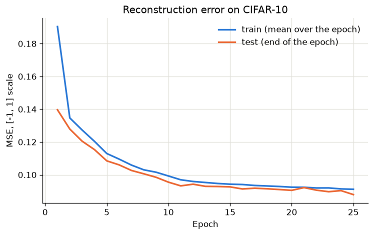
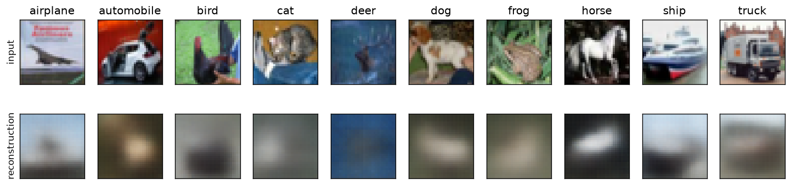
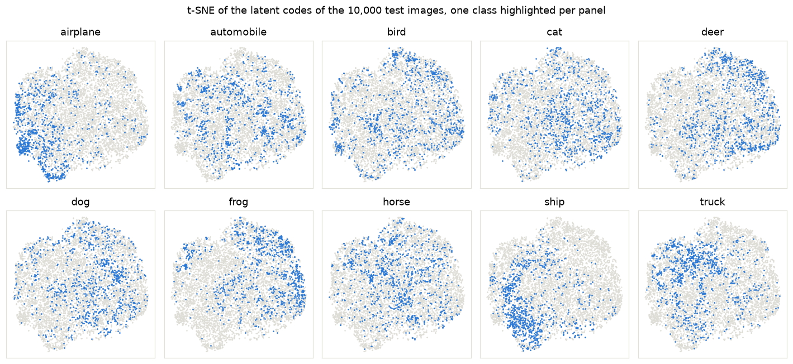

# MobileNetV2 autoencoder on CIFAR-10

A convolutional autoencoder built from MobileNetV2 inverted residual blocks, in PyTorch. The encoder compresses a 32x32 CIFAR-10 image into a code of 320 numbers, and the decoder rebuilds the image from it with transposed convolutions. The notebook trains it with a mean squared error loss, measures the test error, shows reconstructions and maps the codes with t-SNE.

[](https://colab.research.google.com/github/NessimBenA/Mobilenetv2_Autoencoder/blob/main/Mobilenetv2_autoencoder.ipynb)

## Model

- Encoder: a 3x3 stride-2 convolution, then 17 inverted residual blocks (1x1 expansion, 3x3 depthwise convolution, 1x1 linear projection) that go from 32 channels at 16x16 to 320 channels at 1x1.
- Decoder: 16 inverted residual blocks with transposed depthwise convolutions, back to 16 channels at 16x16, then a transposed convolution to 3 channels at 32x32 and a tanh.
- As in MobileNetV2, a block adds its input to its output when its stride is 1 and its input and output channels match. That applies to 10 blocks of the encoder and 9 of the decoder.
- 4,259,088 parameters.

## Run

On Colab: open the notebook from the badge above, pick a GPU runtime and run all cells.

Locally:

```bash
python3 -m venv .venv
source .venv/bin/activate
pip install torch torchvision scikit-learn matplotlib nbconvert ipykernel
jupyter nbconvert --to notebook --execute --inplace Mobilenetv2_autoencoder.ipynb
```

torchvision downloads CIFAR-10 into `data/`, and the notebook saves its figures in `figures/`.

## Results

The model is trained for 25 epochs with Adam (learning rate 0.001, batch size 100) on the 50,000 training images, with pixels scaled to [-1, 1]. The outputs in the notebook and the figures below come from one run on an RTX 2000 Ada laptop GPU with torch 2.6.0; the whole notebook took 27 minutes.

| Test set, 10,000 images | [-1, 1] scale | [0, 1] scale |
| --- | --- | --- |
| MSE after 25 epochs | 0.0879 | 0.0220 |

That is a PSNR of 16.6 dB, computed from the mean test MSE. The test MSE was still going down slowly at epoch 25:



The reconstructions keep the colours and the rough layout of each image but lose almost all of the detail:



t-SNE of the codes of the test images, one class highlighted per panel. Classes with similar backgrounds share regions, airplanes and ships on the left and frogs and deer on the right, while the other classes overlap.


